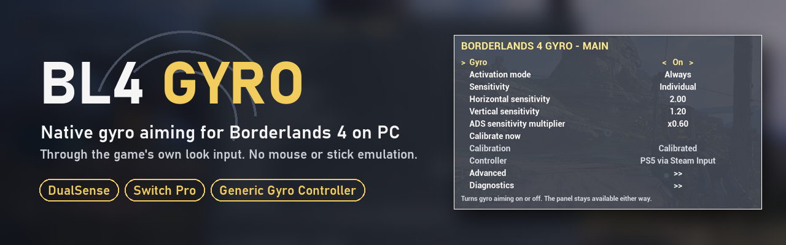
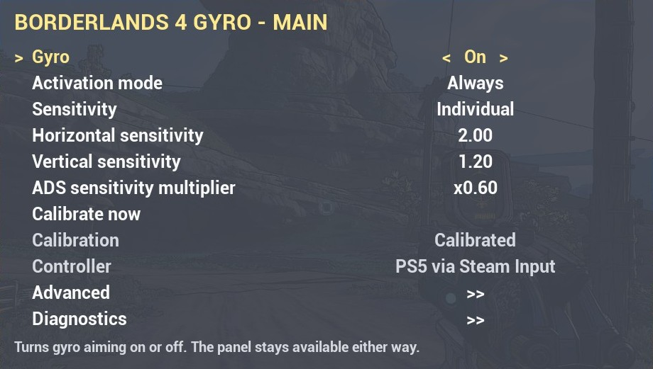
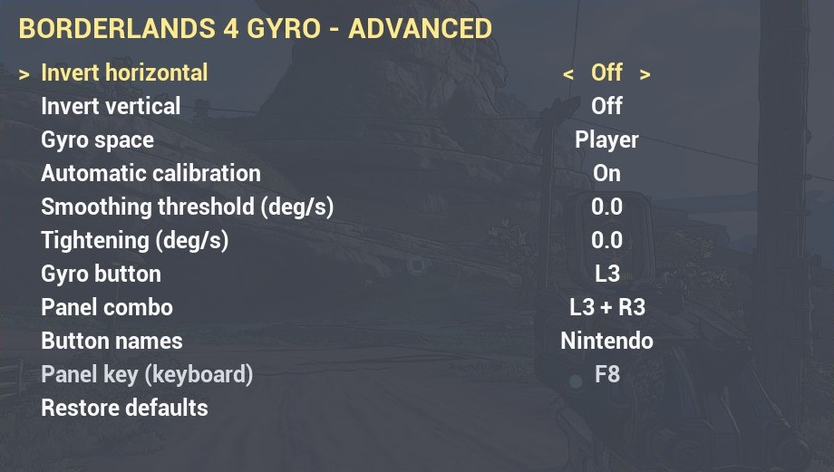

<p align="center">
  
</p>

<h1 align="center">Borderlands 4 Gyro (BL4 Gyro)</h1>

<p align="center">
  <a href="https://github.com/SalustLab/BL4_Gyro/releases/latest"></a>
  <a href="LICENSE"></a>
  
  
  <a href="https://ko-fi.com/SalustLab"></a>
</p>

<p align="center">
  <b><a href="https://github.com/SalustLab/BL4_Gyro/releases/latest">Download</a></b> ·
  <a href="#install">Install</a> ·
  <a href="#using-it">Using it</a> ·
  <a href="#controllers">Controllers</a> ·
  <a href="#limitations">Limitations</a> ·
  <a href="#support">Support</a>
</p>

**Native** motion aiming for Borderlands 4 on PC. The real rotation of your controller's gyro is added to the game's
own camera, through the same path as look input (`AddYawInput`/`AddPitchInput`). There is no mouse or stick
emulation: the right stick keeps working alongside it and the button prompts never switch to keyboard/mouse.

## Features

- **On foot and in vehicles:** as the driver the gyro aims the turret; steering stays on the stick.
- **In-game panel** on the controller (L3 + R3) or keyboard (F8): sensitivity, ADS multiplier, activation mode
  (Always, ADS only, Hold button), gyro button, smoothing, tightening, Player/Local space.
- **Quickstart** on the first launch to check the controller, the combo and the calibration before playing.
- **Calibration that stays out of the way:** automatic in menus, and a manual *Calibrate now* that only needs the
  controller held still.
- **Steam Input or direct HID**, picked automatically.
- **Optional Flick Stick** (Advanced > Right stick mode): the right stick turns the camera toward where you push
  it, gyro aims. Off by default; the right stick keeps the game's own aiming.

## Controllers

| Kind | How the mod reads the gyro | Tested in game | Should work (not verified) |
|---|---|---|---|
| **Generic gyro controller** | Steam Input | **GuliKit TT Max (NS69)** in Switch mode, Bluetooth | Original Switch Pro Controller (same protocol and Steam type as the TT Max), Steam Controller (2026) and other generic gyro controllers Steam Input recognizes |
| **DualSense** | Direct HID (Steam Input off for PlayStation) or Steam Input | DualSense over Bluetooth and USB, both paths; rumble and adaptive triggers keep working | DualShock 4 (same two paths; Bluetooth with Steam Input off is the least certain) |
| **Switch 2 Pro Controller** | Direct HID, through [Switch2Connect](https://github.com/TommyWabg/Switch2Connect) in DualSense mode | Switch 2 Pro Controller | — |

The mod uses Steam Input when it hands a controller to the game. When it hands none (e.g. a DualSense with Steam
Input off, since BL4 supports PlayStation pads natively), it reads the controller's HID directly. The panel's
Diagnostics page shows which source is in use.

## Requirements

- Borderlands 4 (Steam).
- [oak2-mod-manager](https://github.com/bl-sdk/oak2-mod-manager/releases) installed in the game folder (tested with
  **v0.3**): download `oak2-sdk.zip` from its release and extract it into the Borderlands 4 folder.
- A controller with a gyro (see [Controllers](#controllers)).
- Generic gyro controller (e.g. TT Max): **Switch mode** (double-click Mode) and, in Steam > Settings > Controller,
  **Nintendo Switch** support on.
- DualSense: works with Steam's PlayStation support off for the game (BL4 gets the native pad) or on.
- Switch 2 Pro Controller: Switch2Connect in **PS5/DualSense** mode, with the app's own gyro (mouse/stick) off. The
  pad then shows up as a DualSense, so set *Button names* to *Nintendo* (Quickstart or Advanced).
- Don't set up gyro-as-mouse in Steam or another app: the rotation would be doubled.

## Install

1. Close the game. Download `bl4-gyro_<version>.zip` from the
   [latest release](https://github.com/SalustLab/BL4_Gyro/releases/latest).
2. Extract it into the Borderlands 4 folder (the one with `Borderlands4.exe` and `OakGame`; in Steam: right-click
   the game > Manage > Browse local files). You get `sdk_mods\BL4Gyro\` there.
3. Start the game. Gyro is **on** from the first launch.

Updating is the same: extract the new zip over the old one and replace the files. Your settings, and your choice to
keep the mod or the gyro off, are kept (they live in `sdk_mods\settings\BL4Gyro.json`, which the zip doesn't
contain).

## Using it

- **Open the gyro panel during gameplay:** hold **L3 + R3** for half a second (click L3 first: the R3 press is
  then held back from the game, so you don't melee), or press **F8** on the keyboard. The combo can be changed in
  the panel (Advanced > Panel combo).
- **In the panel:** D-pad up/down to move, left/right to change, **LB/RB** for fine steps, **A** to select,
  **B** to go back (and to close on the first page). With a keyboard: arrows, Enter, Esc, and type a number on a
  slider (`2.5` or `2,5`) then Enter. The button hints follow the device you used last. Changes apply immediately
  and are saved when you close the panel.
- While the panel is open the game is paused and neither the controller nor the keyboard/mouse act in game;
  closing it never makes the camera jump and never replays a press.
- The first time you play, the **Quickstart** page opens: gyro state, the detected controller, the combo, the
  button names the panel uses (*Auto* follows your controller) and *Calibrate now*. It stays until you pick
  *Got it*: closing it with B brings it back on the next launch (the combo opens it too). After *Got it* the combo
  opens the full panel.

<p align="center">
  
  
</p>

| Panel page | Settings |
|---|---|
| Main | Gyro on/off, activation mode (Always, ADS only, Hold button), sensitivity *Grouped* (one slider for both directions) or *Individual* (horizontal and vertical), ADS multiplier, calibrate now (with progress), controller status |
| Advanced | Invert X/Y, gyro space (Player/Local), automatic calibration, smoothing, tightening, right stick mode (Traditional, Flick Stick) with flick time and flick threshold, gyro button, panel combo, button names (Auto, Xbox, PlayStation, Nintendo), restore defaults |
| Diagnostics | Controller source (Steam Input / HID), motion packets/s, gyro offset, camera hook state and restart, game build, debug trace, copy diagnostics |

- **Gyro button** (Advanced, none by default): in *Hold button* mode the gyro works only while it is held; in
  *Always* / *ADS only* holding it pauses the gyro so you can re-center the controller — release and it continues
  without a jump. The button keeps its own game action.
- **Flick Stick** (Advanced > *Right stick mode*, *Traditional* by default): push the right stick past the *Flick
  threshold* (0.9 = near the edge) and the camera turns toward that direction in *Flick time* (0.1 s): right 90°,
  left 90°, down 180°; (almost) straight up doesn't turn. Keep it pushed and rotate it to keep turning by the same
  angle; let it go back to the center for the next flick. The stick turns only horizontally: vertical aim is the
  gyro's, which keeps working during a flick. Works on foot and in vehicles (turret). It needs gyro on: with gyro
  off the right stick works the traditional way. While it runs the mod sets the game's controller look sensitivity
  to 0 and puts your value back in menus, the pause screen, the gyro panel and when the mod is turned off.
- **Calibration:** usually nothing to do. Automatic calibration removes drift while a menu, the map or pause is
  open and the controller rests (never while you aim or while the gyro panel is open); the panel then shows
  *Auto-calibrated*. If the camera still drifts slowly with the controller still, use *Calibrate now*: hold the
  controller still in your hands, in any position, or rest it on a table (most accurate). You get 5 s, it measures
  for 4 s and reports *Calibrated*, or *It moved* (the old calibration is kept). Normal hand tremor is fine.
- All options are also in the console mod menu (`F6`, `mods`), where the keyboard key for the panel can be rebound.

## Limitations

- **Generic gyro controllers:** gyro only in Switch mode (PC/XInput mode sends no motion data to the PC),
  triggers are digital in that mode, and Steam Input must stay on with "Nintendo Switch" support enabled.
- **Motion only while the game window has focus.** In game Steam delivers about 48 readings/s with short gaps; the
  mod holds the last speed for up to 0.1 s to cover them.
- **The panel's controller buttons can't be held back from the game**, so the panel opens only during gameplay and
  pauses the game while open. With L3 + R3, press L3 first: the first button of a combo reaches the game. The gyro
  button also keeps its game action.
- **Gyro is off** with a cursor visible, while paused and when the camera is away from your character or vehicle
  (cutscenes).
- **Flick Stick changes a game setting while you play.** The game saves its controller look sensitivity with your
  profile, so if the game crashes during gameplay the 0 can be saved; the mod repairs it on the next launch. If you
  remove the mod right after such a crash, set *Look sensitivity* (controller) back in the game's options.
- **Tested game build: Steam 26007962.** A game patch can change the input scales or break oak2-mod-manager until
  bl-sdk updates it; another build logs a warning. All options stay available in the console mod menu (`F6`, `mods`).
- **Not tested:** co-op (should work fine but I have no friends to test with, if someone does please do tell me if
  it works properly), generic gyro controllers other than the GuliKit TT Max, the original Switch Pro Controller,
  the Steam Controller (2026) and the DualShock 4.

## Uninstall

Delete the `sdk_mods\BL4Gyro` folder in the game folder. To also drop your gyro settings, delete
`sdk_mods\settings\BL4Gyro.json`.

## Development

```
build.cmd                                                   (builds and runs the tests)
powershell -ExecutionPolicy Bypass -File scripts\package.ps1      (writes dist\bl4-gyro_<version>.zip and the SHA-256s)
powershell -c "Expand-Archive dist\bl4-gyro_<version>.zip '<game folder>' -Force"   (installs it, like a player)
```

Before publishing a release: `build.cmd` with no failures, build the zip, send `bl4gyro.dll` to VirusTotal and
publish the SHA-256s with the release.

## License and credits

Open source under the [MIT license](LICENSE).

- GamepadMotionHelpers v10 (MIT, vendored in `third_party/`).
- SDL3 3.4.16 (zlib), fetched at build time; `SDL3.dll` ships in the package for the direct HID reading.
- oak2-mod-manager / unrealsdk / pyunrealsdk (LGPL-3.0): not redistributed; players install the official
  release themselves.
- Design references: Returnal-Native-Gyro, GyroUE/GyroLib, NeonGyro (MIT) and GyroWiki. No code copied.

## Support

If BL4 Gyro made the game better for you, you can buy me a coffee on [Ko-fi](https://ko-fi.com/SalustLab). Thanks!

<a href="https://ko-fi.com/SalustLab"></a>
